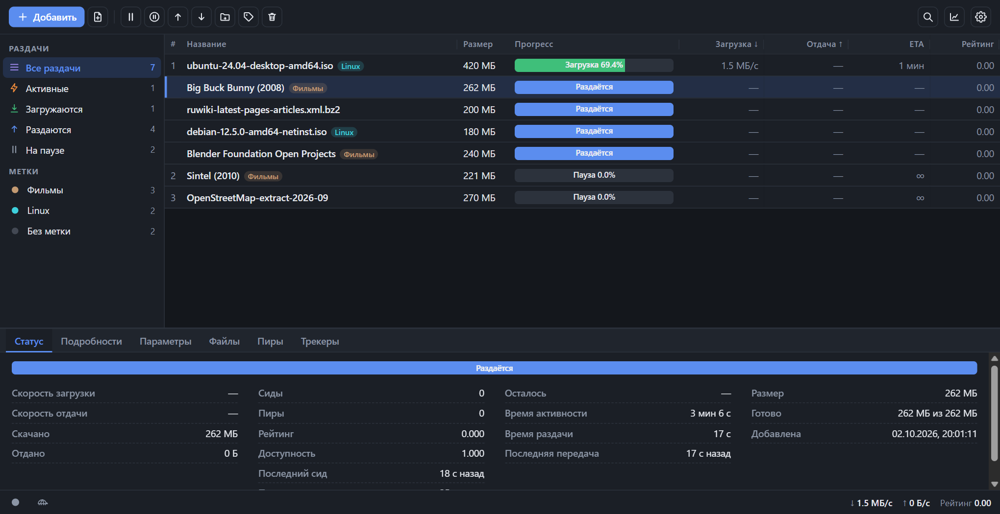
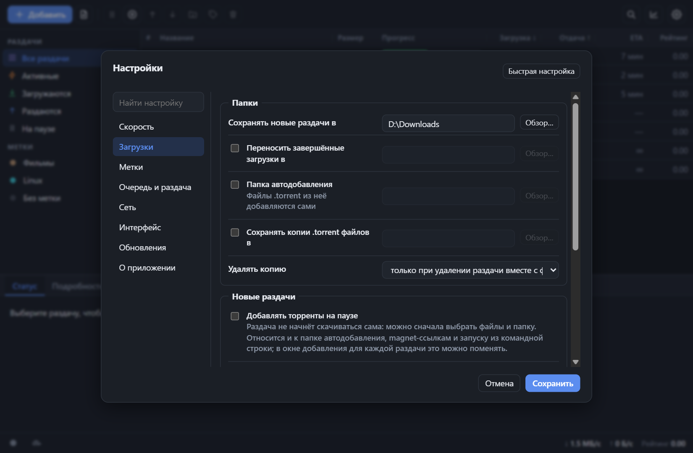
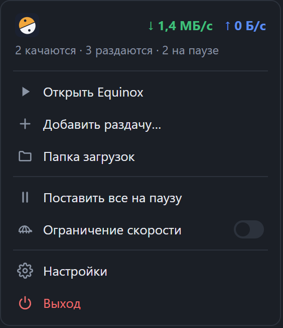

#  Equinox

[](https://github.com/Ozzvin/equinox/releases/latest)
[](https://github.com/Ozzvin/equinox/actions/workflows/test.yml)
[](LICENSE)

**Торрент-клиент для Windows: лёгкий, быстрый, ставится и работает без настройки.**

[Сайт](https://equinoxtorrent.com) · [English version](README.en.md)

Equinox — торрент-клиент для Windows: движок на Go ([anacrolix/torrent](https://github.com/anacrolix/torrent)), веб-интерфейс, вшитый в программу, и окно с треем. Работает как обычное приложение: скачали, запустили, ключи и настройки серверов не нужны. Интерфейс на русском и английском (Настройки → Интерфейс → Язык; по умолчанию язык системы).

## Скачать

**Windows 10/11**

[](https://github.com/Ozzvin/equinox/releases/latest/download/Equinox-Setup.exe)
[](https://github.com/Ozzvin/equinox/releases/latest/download/Equinox-pc.zip)
[](https://github.com/Ozzvin/equinox/releases/latest/download/Equinox-server.zip)

[](https://github.com/Ozzvin/equinox/releases/latest/download/Equinox-Setup-arm64.exe)
[](https://github.com/Ozzvin/equinox/releases/latest/download/Equinox-pc-arm64.zip)
[](https://github.com/Ozzvin/equinox/releases/latest/download/Equinox-server-arm64.zip)

**Linux (бета)**

[](https://github.com/Ozzvin/equinox/releases/latest/download/Equinox-linux-amd64.deb)
[](https://github.com/Ozzvin/equinox/releases/latest/download/Equinox-linux-amd64.rpm)
[](https://github.com/Ozzvin/equinox/releases/latest/download/Equinox-linux-amd64.pkg.tar.zst)
[](https://github.com/Ozzvin/equinox/releases/latest/download/Equinox-linux-amd64.AppImage)
[](https://github.com/Ozzvin/equinox/releases/latest/download/Equinox-linux-amd64.flatpak)
[](https://github.com/Ozzvin/equinox/releases/latest/download/Equinox-server-linux-amd64.tar.gz)

[](https://github.com/Ozzvin/equinox/releases/latest/download/Equinox-linux-arm64.deb)
[](https://github.com/Ozzvin/equinox/releases/latest/download/Equinox-linux-arm64.rpm)
[](https://github.com/Ozzvin/equinox/releases/latest/download/Equinox-linux-arm64.AppImage)
[](https://github.com/Ozzvin/equinox/releases/latest/download/Equinox-server-linux-arm64.tar.gz)

**Docker**

[](https://github.com/Ozzvin/Equinox/pkgs/container/equinox)

Linux и Windows ARM64 — бета: файлы собраны и проверены установкой в сборке, но на живых системах пока не пробовались. Серверные пакеты Linux (.deb, .rpm, pacman) и контрольные суммы — в списке файлов [последнего релиза](https://github.com/Ozzvin/equinox/releases/latest).

## Как это выглядит

<p align="center"></p>

<p align="center">
  
  &nbsp;
  
</p>

## Возможности

**Раздачи**
- Добавление по magnet-ссылкам и файлам `.torrent` (в том числе перетаскиванием и через «Открыть с помощью»), создание своих `.torrent`, папка слежения.
- Выбор файлов и приоритеты для каждого файла, последовательная загрузка, загрузка первых и последних частей файла в первую очередь.
- Ссылка на файл для плеера: видео и музыку можно смотреть по мере загрузки.
- Пиры вручную: адрес `ip:порт`, `[ipv6]:порт` или `имя:порт`. Такие пиры запоминаются и пробуются снова после перезапуска; если с пиром давно нет связи, программа предложит его убрать.
- Большие раздачи начинают качаться сразу: файлы создаются разреженными, и Windows не заливает их нулями заранее.

**Очереди и лимиты**
- Очередь загрузок и лимит одновременных загрузок; лимит одновременных раздач (лишние ждут места, первыми раздают те, у кого есть кому отдавать); проверка файлов и переносы между дисками с ограничением числа одновременных проверок и переносов.
- Лимиты скорости, режим «черепаха» с расписанием, лимиты рейтинга и времени раздачи (общие и для отдельной раздачи).

**Сеть**
- Проброс порта UPnP / NAT-PMP с проверкой состояния и подсказками, DHT, PEX, uTP, шифрование, IPv6.
- В подсказке точки порта виден ваш внешний адрес, на вкладке «Пиры» — число подключённых пиров.

**Порядок в списке**
- Метки со своими папками и цветами, поиск, фильтры по состоянию и трекерам, настраиваемые столбцы, статистика.
- Три плотности интерфейса (в том числе компактный режим без боковой панели), тёмная, светлая или системная тема.

**Windows**
- Меню в трее в стиле приложения: живая скорость и счётчики, пауза и продолжение всех раздач, лимит скорости, добавить раздачу, папка загрузок. Левый клик по значку показывает окно и прячет его снова.
- Уведомления, автозапуск (в том числе тихий, в трее), открытие magnet-ссылок и `.torrent` по умолчанию.
- Автообновление: программа сама проверяет новую версию каждые 15 минут, проверяет контрольную сумму установщика и обновляется с перезапуском.
- Собственное хранилище: файлы не блокируются для других программ, раздачу можно удалять и переносить на ходу.

**Настройки**
- Компактные строки, галочка включает необязательную папку или лимит, поиск по всем настройкам и кнопка «Сбросить раздел к умолчаниям».

## Установка

Скачайте нужный файл на странице [Releases](https://github.com/Ozzvin/equinox/releases):

| Файл | Что это |
|---|---|
| `Equinox-Setup.exe` | установщик; по умолчанию ставит для текущего пользователя без прав администратора |
| `Equinox-pc.zip` | портативная версия для ПК: окно и трей, установка не нужна |
| `Equinox-server.zip` | серверная версия без окна: интерфейс открывается в браузере |

Установщик можно запустить и «для всех пользователей» (выбор в его первом окне или запуск от администратора): тогда программа встанет в `Program Files`, а автообновление будет просить подтверждение в окне Windows (UAC).

Требуется Windows 10/11 и Microsoft Edge WebView2 Runtime (есть в Windows 11 и в большинстве Windows 10; нужен только версии для ПК).

Данные (настройки, список раздач, копии `.torrent`, журнал) лежат в папке `data` рядом с программой (при установке в `Program Files` — в `%LOCALAPPDATA%\Equinox`). Чтобы перенести всё на другой компьютер, копируйте папку целиком.

> Сборки не подписаны, поэтому Windows SmartScreen может показать предупреждение при первом запуске: «Подробнее» → «Выполнить в любом случае».

## Сборка из исходников

Нужны Go 1.27+ и, для установщика, [Inno Setup 6](https://jrsoftware.org/isinfo.php).

```powershell
git clone https://github.com/Ozzvin/equinox.git
cd equinox
.\build.ps1              # проверки, тесты, сборка, установщик и архивы в папке dist
.\build.ps1 -SkipTests   # то же без тестов
```

Вручную:

```powershell
go build -ldflags "-H windowsgui -s -w" -o Equinox.exe ./cmd/equinox   # для ПК
go build -o Equinox-server.exe ./cmd/equinox-server                    # серверная
go test ./...
```

Релизы собирает GitHub Actions (workflow «Build»), тесты с детектором гонок идут на каждый коммит в `main` и `dev`.

## Безопасность

API слушает только `127.0.0.1` и требует ключ доступа (`data/api-token`). Никому не показывайте этот файл. Доступ с других устройств пока не поддерживается.

## Документация

- [docs/details.md](docs/details.md) — подробное описание интерфейса.
- [docs/architecture.md](docs/architecture.md) — устройство проекта для тех, кто будет менять код.
- [CHANGELOG.md](CHANGELOG.md) — история изменений.

## Лицензия

[MIT](LICENSE)
